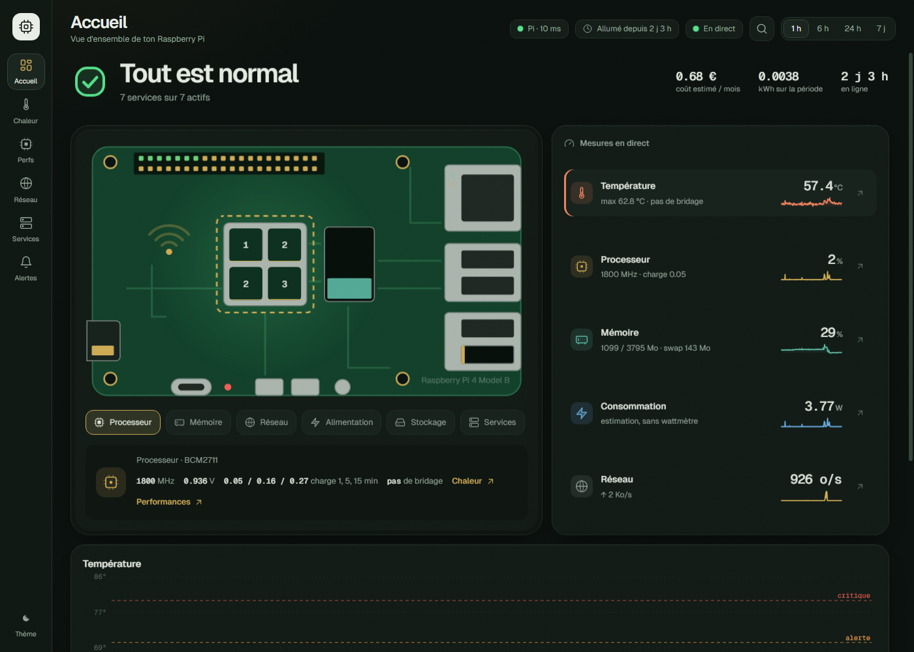
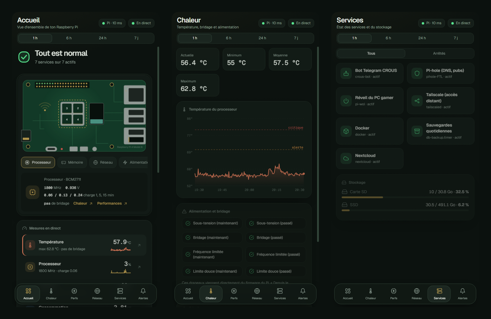
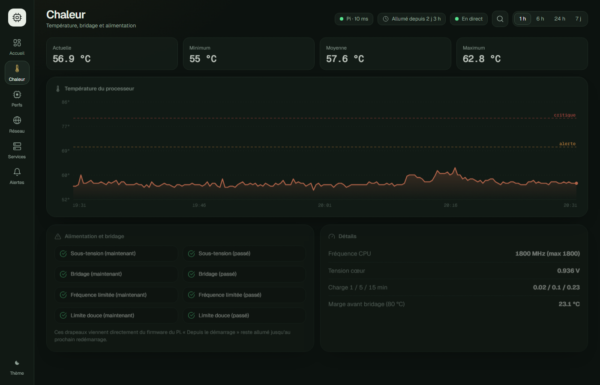
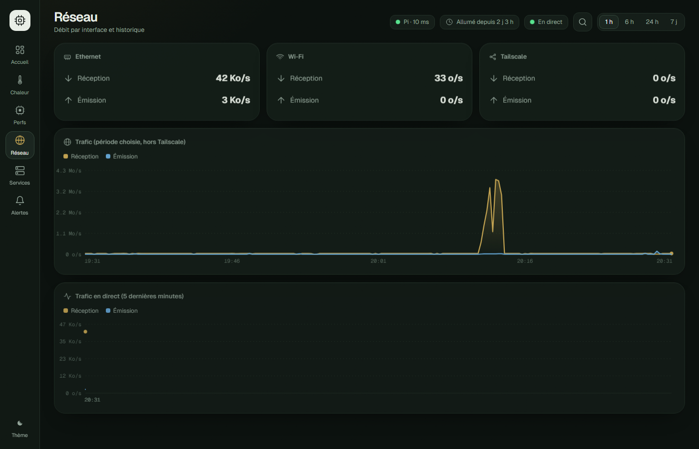

<div align="center">

# Pi Monitor

**Surveille ton Raspberry Pi depuis n'importe où : navigateur, téléphone, Windows.**


<br>



</div>

<br>

## Ce que ça fait

Un tableau de bord où **la carte du Pi est l'interface** : chaque composant dessiné (processeur, mémoire, ports réseau, SD, SSD, alimentation, broches) est lié à une mesure réelle et se clique pour afficher son détail.

| | |
|---|---|
| **En direct** | CPU par cœur, RAM, température, réseau, disques, services, bridage et sous-tension |
| **Historique** | 1 h, 6 h, 24 h, 7 jours, stocké dans SQLite sur le Pi |
| **Interactif** | zoom à la souris sur la courbe, seuils d'alerte déplaçables, palette de commandes, gestes sur mobile |
| **Alertes** | température, charge, service arrêté, sous-tension, avec journal et mise en sourdine |
| **Partout** | un seul code pour le navigateur, le téléphone (PWA installable) et Windows (Electron) |
| **Sobre** | le serveur n'utilise que la bibliothèque standard de Python, rien à installer |

<br>

## Aperçu

<div align="center">

<br><sub>Sur téléphone : accueil, chaleur, services. Barre de navigation flottante, tirer pour actualiser, balayer pour changer de vue.</sub>
</div>

<br>

<table>
<tr>
<td width="50%"><br><sub>Chaleur : courbe, seuils déplaçables, zoom</sub></td>
<td width="50%"><br><sub>Réseau : débit par interface</sub></td>
</tr>
</table>

<br>

## Comment ça marche

```
   Téléphone / PC / Mac / Linux                       Raspberry Pi
  ┌───────────────────────────┐                ┌─────────────────────────┐
  │  Navigateur ou appli      │                │  pi_monitor.py          │
  │  (même code partout)      │   HTTPS        │  ├─ échantillonne (5 s) │
  │                           │ ◄────────────► │  ├─ SQLite (7 jours)    │
  │  core.js  : alertes       │   Tailscale    │  └─ API JSON + jeton    │
  │  bridge.js: pont web      │                │                         │
  │  app.js   : interface     │                │  tailscale serve :443   │
  └───────────────────────────┘                │   └─► 127.0.0.1:8095    │
                                               └─────────────────────────┘
```

```
   ┌──┬──┬──┬──┬──┬──┬──┬──┬──┬──┬──┬──┐
   │• │• │• │• │• │• │• │• │• │• │• │• │   GPIO
   └──┴──┴──┴──┴──┴──┴──┴──┴──┴──┴──┴──┘
      ~~~       ┌───────┐            ┌────────┐
     (   )      │ CPU   │  ┌─────┐   │ RJ45   │ ◄ voyant = trafic réseau
      Wi-Fi     │ 2  1  │  │ RAM │   ├────────┤
                │ 2  5  │  │ ▇▇▇ │   │ USB    │
   ┌──┐         └───────┘  └─────┘   ├────────┤
   │SD│  ◄ jauge = remplissage        │ USB/SSD│ ◄ jauge = remplissage
   └──┘                               └────────┘
        [USB-C]  ●
```

<sub>La carte du dessus, en vrai, est un SVG animé : la hauteur de chaque cœur suit sa charge, les voyants clignotent avec le trafic, la teinte de la carte chauffe avec la température.</sub>

<br>

## Installation

### 1. Sur le Pi

```bash
# copier le serveur
sudo mkdir -p /mnt/ssd/pi-monitor && sudo chown $USER /mnt/ssd/pi-monitor
cp pi-server/pi_monitor.py /mnt/ssd/pi-monitor/
cp -r desktop/renderer /mnt/ssd/pi-monitor/web      # l'interface web / PWA

# adapter User= et les chemins, puis activer le service
sudo cp pi-server/pi-monitor.service /etc/systemd/system/
sudo systemctl enable --now pi-monitor

cat /mnt/ssd/pi-monitor/token                        # ton jeton, créé au premier démarrage
```

Le dossier se règle avec `PI_MONITOR_DIR`, le port avec `PI_MONITOR_PORT` (8095 par défaut).

### 2. Choisir comment y accéder

| Mode | Réglage | Pour qui |
|---|---|---|
| **Maison** | rien (écoute sur `0.0.0.0`), ouvrir `http://<ip-du-pi>:8095` | réseau local de confiance |
| **Partout** | `PI_MONITOR_BIND=127.0.0.1` puis `tailscale serve --bg 8095` | recommandé : HTTPS, chiffré, tailnet seulement |

### 3. Sur tes appareils

| Appareil | Marche à suivre |
|---|---|
| **iPhone / iPad** | Safari, ouvrir l'adresse, Partager, « Sur l'écran d'accueil » |
| **Android** | Chrome, menu ⋮, « Installer l'application » |
| **Mac / Linux** | Chrome ou Edge, icône d'installation dans la barre d'adresse |
| **Windows** | idem, ou l'appli Electron (`cd desktop && npm install && npm run dist`) |

**Appairage :** ouvrir une fois `https://<ton-pi>.<ton-tailnet>.ts.net/#t=<jeton>`. Le jeton est mémorisé sur l'appareil.

<br>

## Sécurité

Pensé pour être exposé sans stress :

- **Jeton aléatoire** de 32 octets, créé au premier démarrage, fichier en mode `600`, jamais dans le dépôt.
- **Limite d'essais** : 10 mauvais jetons par minute et par adresse, puis erreur 429.
- **Aucune exposition publique** : avec `PI_MONITOR_BIND=127.0.0.1` et Tailscale Serve, seuls les appareils de ton tailnet l'atteignent, en HTTPS.
- L'API est protégée, seuls `/api/health` et les fichiers statiques de l'interface sont ouverts.

Durcissement conseillé pour le Pi lui-même : SSH par clé seulement, `ufw` en refus par défaut (autoriser `tailscale0` et ton réseau local), `fail2ban`, `unattended-upgrades`, et couper les services inutiles comme `rpcbind`.

> La consommation affichée est une **estimation** (formule selon la charge CPU) : le Pi 4 n'a pas de capteur de puissance.

<br>

## Structure

```
pi-monitor/
├─ pi-server/
│  ├─ pi_monitor.py          serveur : mesures, SQLite, API
│  └─ pi-monitor.service     unité systemd
└─ desktop/
   ├─ main.js, preload.js    appli Windows (tray, widgets, alertes)
   └─ renderer/              interface partagée web + Electron
      ├─ index.html, app.js, style.css
      ├─ core.js             connexion, alertes, journal
      ├─ bridge.js           pont navigateur
      ├─ common.js           graphiques SVG, icônes animées
      └─ sw.js, manifest     PWA, hors ligne
```

<br>

## Limites connues

- Sur téléphone, les notifications ne partent que tant que l'application est ouverte (pas de serveur push).
- L'appli Electron n'est construite que pour Windows pour l'instant. Mac et Linux passent par la PWA.

<br>

<div align="center"><sub>Fait pour un Raspberry Pi 4, testé sur Debian 13.</sub></div>
